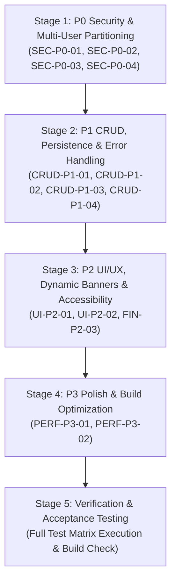

# SAFE REPAIR PLAN — ATUL EXPENSE MANAGER
**Document Version**: 1.0  
**Target Application**: https://atul-expense-manager.vercel.app/  
**Execution Mode**: Staged, Test-Driven & Read-Only until Approval  

---

## 1. Principles & Safety Constraints

1. **Zero Production Risk**: No code shall be deployed or production data modified without explicit user approval.
2. **Preservation of Baseline Data**: Atul's 78 original rows (₹17,136.00 valid total, ₹10,000.00 reimbursement) must remain 100% intact and verified after every change.
3. **Missing Amounts Preserved**: Any record with missing financial data (`exp-075`, amount `null`) must remain incomplete and never coerced to ₹0.00.
4. **No Premature Success Notifications**: A success toast must appear only after persistent database confirmation.
5. **No Blind Global Storage**: All personal user data (expenses, trips, reimbursements, members, invitations, chat messages, notifications, proofs) must reside within namespaced partitions.

---

## 2. Ordered Repair Stages & Dependencies



---

## 3. Detailed Step-by-Step Implementation Plan

### Stage 1: P0 Security & Multi-User Boundary Isolation

#### Step 1.1: Partition Workspace Members & Invitations (`SEC-P0-01`)
- **Files**: `src/services/backendService.ts`
- **Actions**:
  - Update `getWorkspaceMembers()` to use `this.getUserStorageKey('members_v1')`.
  - For the verified primary owner (`isOwnerEmail`), default to `[INITIAL_OWNER, Praakj]`.
  - For newly registered users, initialize members to contain only the registered user's profile (`role: 'owner'`).
  - Update `getInvitations()` and `inviteManager()` to namespace invitations per user workspace.
- **Regression Test**: Register User A (`Alice`) and User B (`Bob`). Verify `Alice` cannot see Atul or Bob in `getWorkspaceMembers()`.

#### Step 1.2: Restrict "Reset to Pristine Seed" to Verified Owner Only (`SEC-P0-02`)
- **Files**: `src/services/backendService.ts`, `src/pages/SettingsPage.tsx`
- **Actions**:
  - In `resetAllData()`, check `isOwnerEmail(this.currentUser.email)`.
  - If the caller is the verified owner, restore the 78 baseline spreadsheet records.
  - If the caller is a registered personal user, reset their personal storage partition to empty (`[]`) rather than injecting Atul's records.
  - Prevent non-owners from writing to `STORAGE_KEYS.EXPENSES`.
- **Regression Test**: Invoke `resetAllData()` while authenticated as `Alice`. Verify Alice's expenses array is `[]` and Atul's baseline is unaffected.

#### Step 1.3: Namespace Chat Messages & Dynamic Notification Recipients (`SEC-P0-03`)
- **Files**: `src/services/backendService.ts`
- **Actions**:
  - Update `getMessages()` and `sendMessage()` to store messages in `this.getUserStorageKey('messages_v1')`.
  - Update `getNotifications()` and `createNotification()` to use `this.getUserStorageKey('notifications_v1')`.
  - Remove hardcoded recipient fallback (`INITIAL_OWNER.id` / `INITIAL_MANAGER.id`) when creating notifications.
- **Regression Test**: Send a chat message as `Alice`. Verify message does not appear in Atul's message list.

#### Step 1.4: Eliminate Unauthenticated URL Parameter Auto-Login (`SEC-P0-04`)
- **Files**: `src/App.tsx`
- **Actions**:
  - Remove the auto-login branch in `App.tsx` lines 164–184 that called `loginWithCredentials(cleanEmail)` without credentials.
  - Instead, pre-fill the email address in `PublicAuthPortal` or `SignInModal` and require the user to input their password or click a verified magic/reset link.
- **Regression Test**: Navigate to `/?email=praakj@gmail.com`. Verify the user is prompted for credentials and not automatically authenticated.

---

### Stage 2: P1 CRUD, Persistence & Error Handling

#### Step 2.1: Finalize & Preserve Delete Expense Fix (`CRUD-P1-01`)
- **Files**: `src/services/backendService.ts`, `src/pages/ExpensesPage.tsx`, `src/App.tsx`
- **Actions**:
  - Keep the removal of the auto-resurrection loop in `getExpenses()`.
  - Ensure `deleteExpense(id)` throws `404` for missing IDs and `403` for cross-user deletion.
  - In `ExpensesPage.tsx`, notify success strictly inside try/catch after deletion resolution.
- **Regression Test**: Execute `scripts/verify-delete-expense.js` (32 tests passing).

#### Step 2.2: Finalize Trips Delete Persistence (`CRUD-P1-02`)
- **Files**: `src/services/backendService.ts`
- **Actions**:
  - Keep the removal of the auto-resurrection loop in `getTrips()`.
  - Ensure `deleteTrip(id)` throws an error if the trip ID does not exist.
  - In `TripsPage.tsx`, wrap `onDeleteTrip` in try/catch and notify only on confirmation.
- **Regression Test**: Delete a trip, reload state, and verify trip does not resurrect.

#### Step 2.3: Add Strict ID Validation to All Mutation Methods (`CRUD-P1-03`)
- **Files**: `src/services/backendService.ts`, `src/pages/ReimbursementsPage.tsx`, `src/pages/PaymentProofsPage.tsx`
- **Actions**:
  - Update `deleteReimbursement(id)` to throw `'Reimbursement record with ID "..." was not found'` if non-existent.
  - Update `deletePaymentProof(id)` to throw `'Payment proof record with ID "..." was not found'` if non-existent.
  - Wrap UI confirmation handlers in try/catch blocks.
- **Regression Test**: Call `deleteReimbursement('fake-id')`. Verify error toast is displayed and list remains intact.

#### Step 2.4: Partition Backup Restoration (`CRUD-P1-04`)
- **Files**: `src/services/backendService.ts`
- **Actions**:
  - Update `restoreBackup()` to write to `this.getUserStorageKey('expenses_v2')`, `reimbursements_v1`, and `trips_v2`.
  - Write to legacy global keys only when `isOwnerEmail(this.currentUser.email)` is true.
- **Regression Test**: Restore backup as User A. Verify records appear in User A's active dashboard.

---

### Stage 3: P2 UI/UX, Dynamic Banners & Accessibility

#### Step 3.1: Dynamic Incomplete Records Alert Banner (`UI-P2-01`)
- **Files**: `src/pages/DashboardPage.tsx`
- **Actions**:
  - Replace hardcoded `"Row 80 (Grabbit location gurgaon)"` text with dynamic summary.
  - Derive incomplete records from current scope:
    ```tsx
    const incompleteItems = searchedExpenses.filter(e => e.status === 'incomplete' || e.amount === null);
    const summaryText = incompleteItems.length === 1 
      ? `"${incompleteItems[0].description || 'Untitled'}" is missing an amount and is safely excluded from financial totals.`
      : `${incompleteItems.length} records are missing amounts and are safely excluded from totals until reviewed.`;
    ```
- **Regression Test**: Verify banner displays correct dynamic description when `exp-075` is present, and updates when other incomplete expenses are logged.

#### Step 3.2: Accessible Table Sorting Headers (`UI-P2-02`)
- **Files**: `src/components/ExpenseTable.tsx`
- **Actions**:
  - Add `aria-sort={sortField === 'date' ? (sortOrder === 'asc' ? 'ascending' : 'descending') : 'none'}` to table column headers.
  - Add accessible screen reader text (`sr-only`) describing active sort order.
- **Regression Test**: Inspect DOM attributes on table headers when clicking column sort.

#### Step 3.3: Clarify Metrics Denominator Terminology (`FIN-P2-03`)
- **Files**: `src/pages/ExpensesPage.tsx`
- **Actions**:
  - Label the card as `"Avg per Transaction"` instead of generic `"Average Expense"` to avoid confusion with the Dashboard's `"Daily Average (per active day)"`.
- **Regression Test**: Check Expenses page summary cards.

---

### Stage 4: P3 Polish & Build Optimization

#### Step 4.1: Support ₹0.00 Expenses in Analytics (`PERF-P3-01`)
- **Files**: `src/pages/AnalyticsPage.tsx`
- **Actions**:
  - Change `validExpenses` filter condition from `e.amount > 0` to `e.amount !== null && !isNaN(e.amount)`.
- **Regression Test**: Log an expense with amount 0. Verify it displays in Analytics.

#### Step 4.2: Vite Bundle Chunk Splitting (`PERF-P3-02`)
- **Files**: `vite.config.ts`
- **Actions**:
  - Configure `build.rollupOptions.output.manualChunks` to split vendor libraries (`vendor-react`, `vendor-recharts`, `vendor-xlsx`, `vendor-lucide`).
- **Regression Test**: Run `npm run build` and verify all chunks are under 500 kB.

---

## 4. Proposed Files for Modification

1. `src/services/backendService.ts` (Partition members, invitations, chat messages, notifications, backup restore, delete validations)
2. `src/App.tsx` (Remove unauthenticated URL auto-login bypass)
3. `src/pages/DashboardPage.tsx` (Dynamic incomplete record banner text)
4. `src/pages/ExpensesPage.tsx` (Delete error handling, terminology clarity)
5. `src/pages/ReimbursementsPage.tsx` (Delete error handling & try/catch)
6. `src/pages/TripsPage.tsx` (Delete error handling & try/catch)
7. `src/pages/PaymentProofsPage.tsx` (Delete error handling & try/catch)
8. `src/pages/AnalyticsPage.tsx` (Support ₹0.00 expenses)
9. `src/components/ExpenseTable.tsx` (Table a11y sorting headers)
10. `vite.config.ts` (Vendor chunk splitting optimization)
